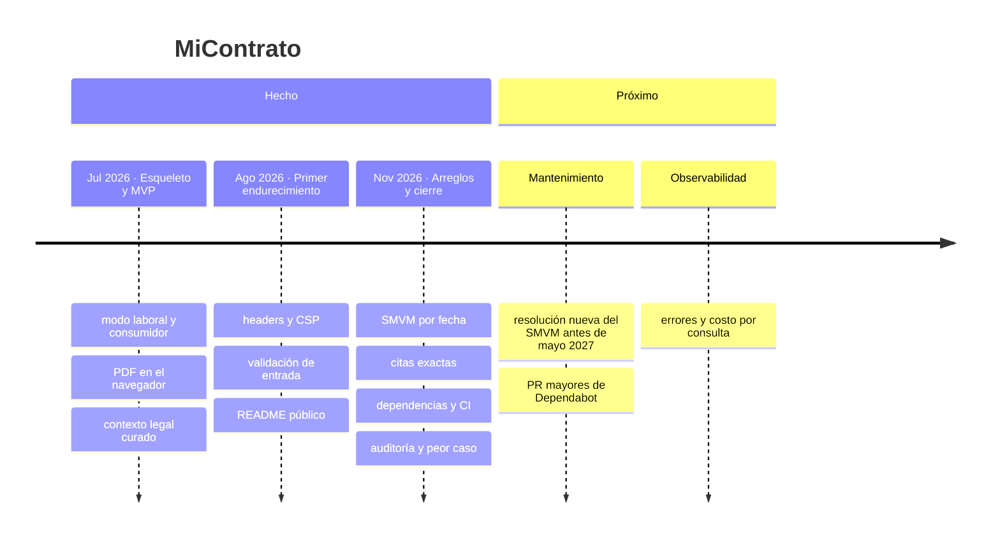

# MiContrato — handoff

**Estado:** en producción en [micontratoar.vercel.app](https://micontratoar.vercel.app). Analiza contratos, recibos y facturas; el cierre del 15/11/2026 corrigió la auditoría y la prueba de peor caso. · **Última actualización:** 15/11/2026
**Lenguaje:** TypeScript (Next.js 15, App Router) · **Forma:** simple (un endpoint, sin base de datos)
**Correr:** `npm run dev` · **Tests:** `npm test` · **Deploy:** merge a `main` → Vercel (ver "Para decidir")

## Roadmap

| Etapa | Qué incluye | Estado | Criterios (SPEC) |
|---|---|---|---|
| MVP | modos, extracción de PDF, análisis, recursos | ✅ | CA-1 a CA-10, CA-14 |
| Endurecimiento | headers, validación, rate limit | ✅ | CA-2 a CA-4, CA-11 |
| Arreglos #1, #2 y #4 | SMVM por fecha, citas exactas, CI | ✅ (`v0.1.1`) | CA-7, CA-12, CA-13 |
| Cierre | spec, tests, auditoría, peor caso, docs | 🔧 PR abierto | CA-15 a CA-18 |

## Qué se hizo (lo último arriba)

- 15/11 · **Cierre de proyecto** (rama `chore/cierre-proyecto`):
  - **Spec y tests:** `docs/SPEC.md` con 18 criterios; la suite pasó de 34 a 135 tests.
  - **Peor caso:** 59 tests en `tests/peor-caso/`, de los que fallaban 18.
  - **Auditoría:** 1 alto, 4 medios y 5 bajos, todos corregidos salvo M4, que queda aceptado.
  - **Docs:** ADRs 0001 a 0008, `SECURITY.md`, `LICENSE` (MIT) y versión 0.2.0.
- 15/11 · Issues #1, #2 y #4 mergeados y promovidos a producción (`v0.1.1`). Issue #3 cerrado como "no planeado" (ADR-0005).
- 05/08 · README público y Next 15.5.22.
- 15/07 · Primera versión.

## Qué sigue

1. **Antes de mayo de 2027:** cargar la resolución del Consejo del Salario que siga a la 4/2026 en `SMVM_ESCALONES` (`lib/legal-data.ts`). El test canario hace fallar la CI semanal cuando la tabla no cubre el mes.
2. **PR de Dependabot abiertos:** #8 (menores), #9 (pdfjs 6), #10 (TypeScript 7), #11 (@types/node 26) y #12 (Next 16). Revisarlos uno por uno, sin automerge. Al pasar a Next 16, sacar el `overrides` de postcss (ADR-0004).
3. **Observabilidad:** hoy no hay forma de enterarse de un error en producción ni del costo por consulta, salvo la consola de Anthropic. Issue de deuda.
4. **Verificar `laboral.md` contra el texto vigente de las Leyes 27.742 y 27.802** y, si se confirma, actualizar `ARTICULOS_REFORMADOS_LABORAL`.

## Decisiones que tomé (para vetar)

- **Las citas dudosas bajan a "A verificar".** Toda irregularidad con una cita no verificada o a un artículo reformado (LCT 92 bis y 245, Ley 24.013 arts. 8 a 10, Ley 25.323 art. 1) sale con certeza "requiere_verificacion", aunque el modelo diga "alta". Va a aparecer más seguido el badge "A verificar". (ADR-0007, `route.ts`)
- **Una cita "Ley 20.744" sin artículo también queda "A verificar"**, porque la LCT tiene artículos reformados.
- **Los `<` y `>` del documento llegan al modelo como `‹` y `›`**, y el texto se normaliza con NFKC. (ADR-0008)
- **Una cita con una ley que no se puede leer** ("Ley 120.744", "Ley de Sociedades") ya no hereda la LCT y sale "no verificada".
- **Respuesta cortada por `max_tokens`:** mensaje propio ("El análisis salió demasiado largo…") en vez del genérico.
- **Body o documentos que no son objetos:** 400 "Solicitud inválida." en vez de 500.
- **Portada:** "No guardamos tus documentos por default" pasa a "No guardamos tus documentos". **README:** aclara que también viaja el nombre del archivo.
- **CI semanal** (lunes, 12:00 UTC), además de en PRs y en push a `main`.
- **Versión 0.2.0** (menor, porque cambia comportamiento visible). El tag se crea después del merge.

## Para decidir

- **Prender el reporte privado de vulnerabilidades** en el repo: `SECURITY.md` apunta a ese formulario y hoy está apagado. Comando: `gh api -X PUT repos/malenitaa/micontrato/private-vulnerability-reporting`.
- **Prender Dependabot alerts y security updates** (Settings → Code security).
- **Vercel:** el merge a `main` del 15/11 salió como Preview y hubo que promoverlo a mano. Mirar en el próximo merge si se repite.
- **`docs/interno/DISENO.md` está gitignoreado:** existe solo en esta copia local. Si querés que no se pierda, ofrezco un repo privado aparte.
- **Pasar la portada por la skill `web-sin-ia`:** no se corrió en este cierre.

## Pendientes y deudas conocidas

- Rate limit en memoria por instancia; techo de gasto = saldo prepago (ADR-0005).
- Límite de entrada en caracteres, no en tokens (AUDITORIA M4, aceptado).
- `script-src 'unsafe-inline'` en la CSP (lo requiere Next sin nonces).
- Código muerto en `route.ts`: chequeo de `MAX_DOCUMENTOS` repetido.
- Sin OCR para PDFs escaneados.
- CA-14 (PDFs ilegibles) sin test automático: es código de navegador.

## Dónde está todo

| Qué | Dónde |
|---|---|
| Spec y criterios | `docs/SPEC.md` |
| Decisiones | `docs/adr/` (índice en `docs/adr/INDICE.md`) |
| Diseño interno | `docs/interno/DISENO.md` (gitignoreado, solo local) |
| Auditoría | `docs/AUDITORIA.md` |
| Para externos | `README.md`, `SECURITY.md`, `LICENSE` |
| Tests | `*.test.ts` junto al código (criterios) y `tests/peor-caso/` |
